# Marble Hop 中国跳棋

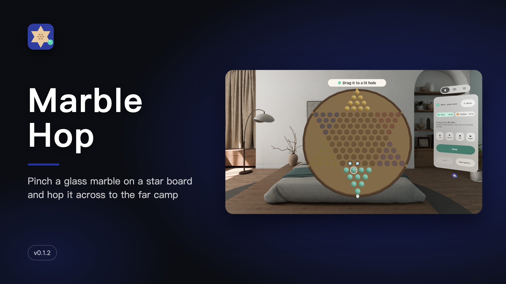

**English** · [中文](#中文)

A 0.9 m star board stands in front of you with 60 glass marbles. Pinch one, every hole it can reach lights up, drag
and let go, and it hops its way there. 2, 3, 4 or 6 players, against two levels of bots or passing one headset around.

PICO OS 6 Shared Space app (PICO Spatial SDK 6.1.9, Kotlin, SpatialUI). Offline, Chinese and English.

- Board volume 1.02 x 1.16 x 1.16 m + control window 320 x 640 dp (Game / Rules / Settings).
- Full rules: steps, chained hops, no stopping in other camps, home marbles stay home, the squatter win rule.
- Easy and smart bots, pass-and-play hot seat with an automatic board turn and hand-over screen.
- Pick by pinch + drag, or tap, tap, tap again; arrow keys on the panel when a hole is hard to hit.
- Marble sounds are CC0 recordings of real glass marbles (freesound, Kenney).

| | |
|---|---|
| 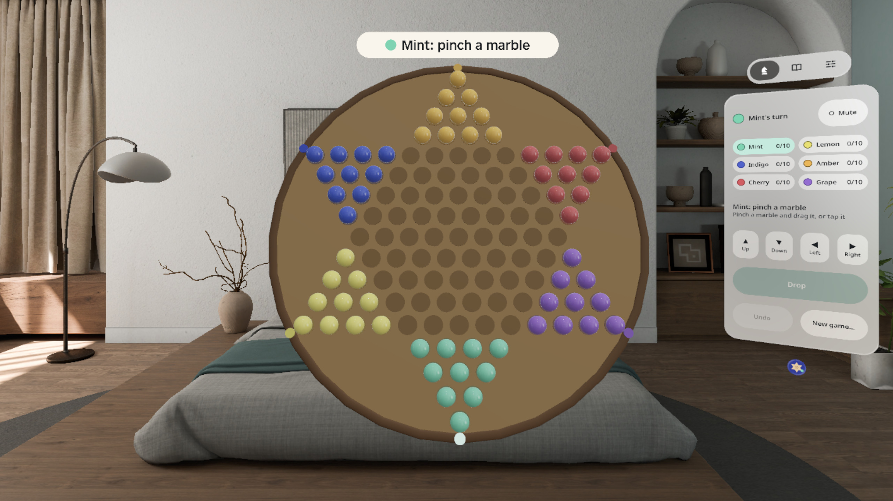 | 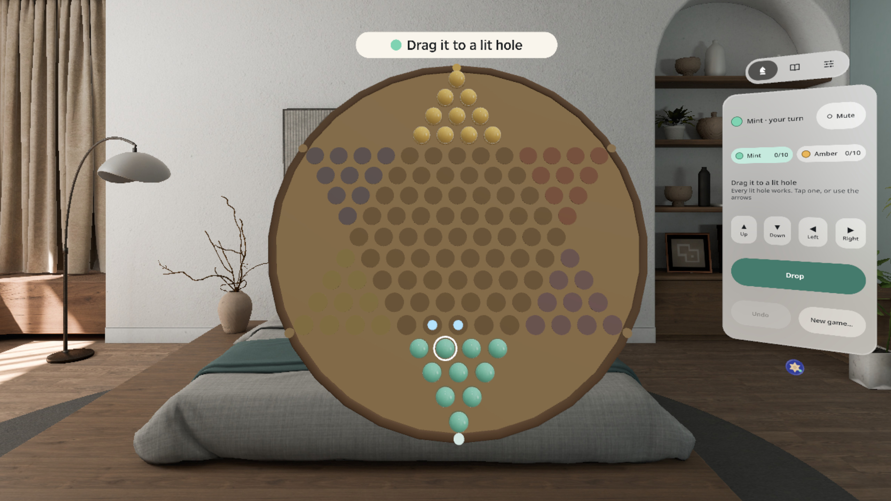 |
| 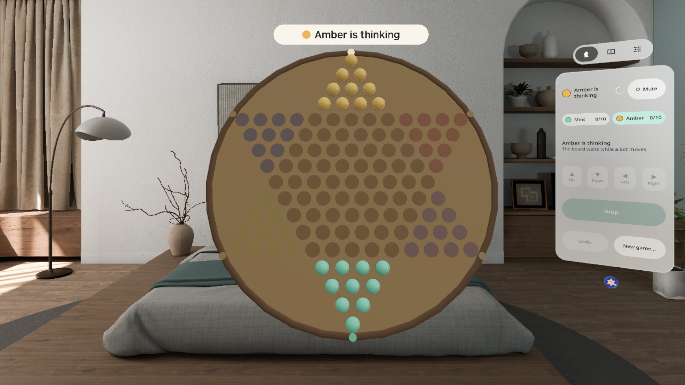 | 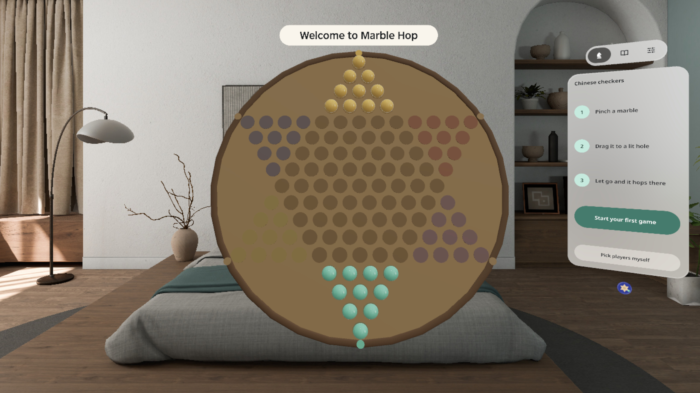 |
| 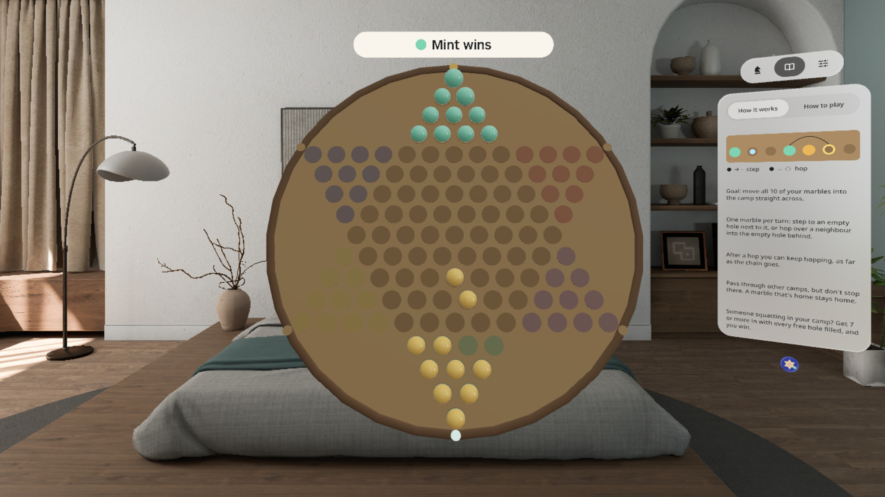 | 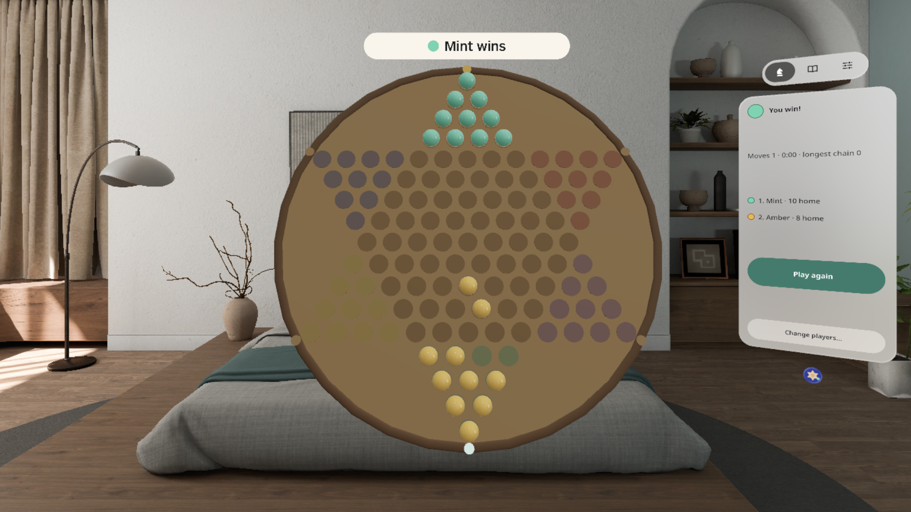 |

Screenshots and the demo video were captured in the PICO emulator, driven by debug commands. They are not
recordings of real hand gestures.

### Install

Download `MarbleHop-v0.1.2.apk` from the [v0.1.2 release](https://github.com/kejing-dev/MarbleHop/releases/tag/v0.1.2)
(unsigned release build; sign it or build your own debug APK with `./gradlew assembleDebug`), then:

```
adb install -r MarbleHop-v0.1.2.apk
pico-cli app launch io.embodit.marblehop
```

Developer notes, debug commands and the QA screenshot list: [AGENTS.md](AGENTS.md).

---

## 中文

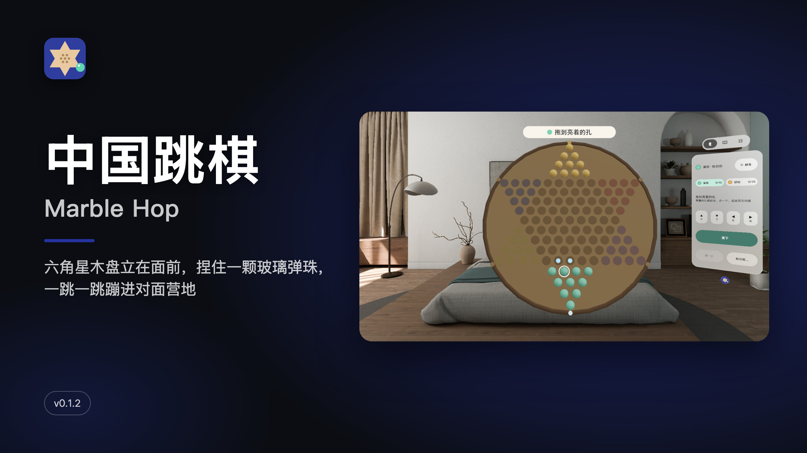

一张 0.9 米的六角星木盘立在你面前，60 颗玻璃弹珠嵌在槽里。捏住一颗，它能去的孔全部亮起来；拖到哪个孔松手，它就一跳一跳蹦过去。
2 / 3 / 4 / 6 人，对入门电脑、聪明电脑，或一台头显轮着戴。

PICO OS 6 共享空间应用（PICO Spatial SDK 6.1.9、Kotlin、SpatialUI），全离线，中英双语。

- 棋盘放在系统立体窗口（1.02 × 1.16 × 1.16 m），控制窗 320 × 640 dp 挂在右边（对局 / 规则 / 设置）
- 规则完整：走一步、连跳、别人的营地不能停、进营的珠不出营、占营判输赢
- 入门 / 聪明两档电脑；同机轮流自动转盘、提示交给下一位
- 捏住拖过去松手，或点珠、点孔、再点一次；孔不好点时用面板方向键
- 落槽声是真实玻璃弹珠的 CC0 录音（freesound、Kenney）

| | |
|---|---|
|  | 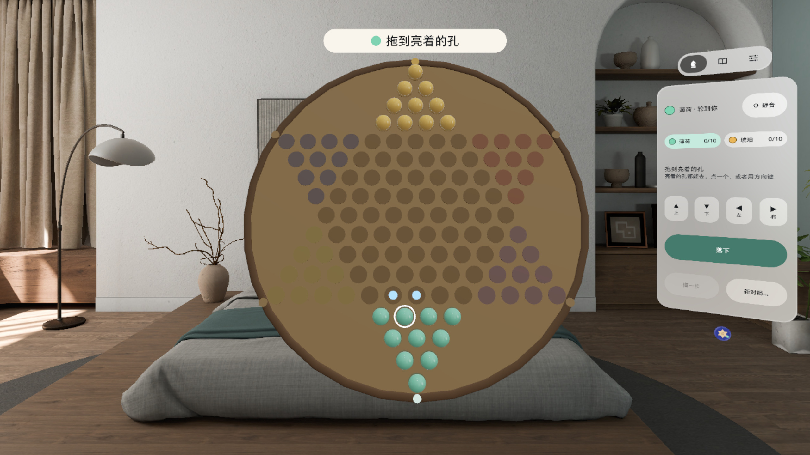 |
| 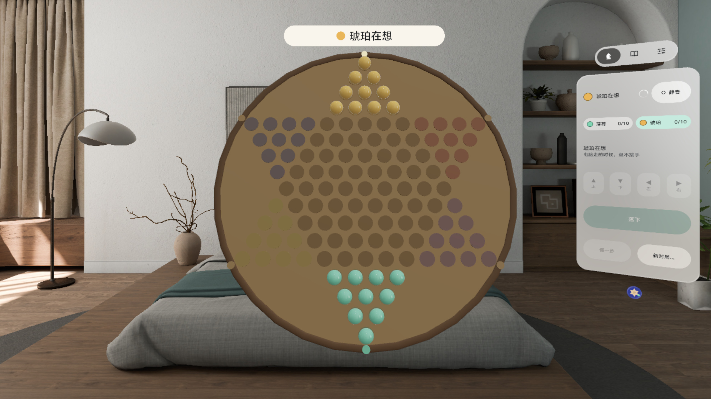 | 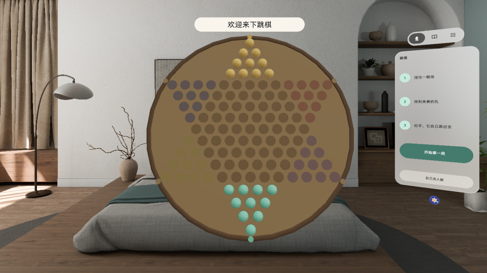 |
| 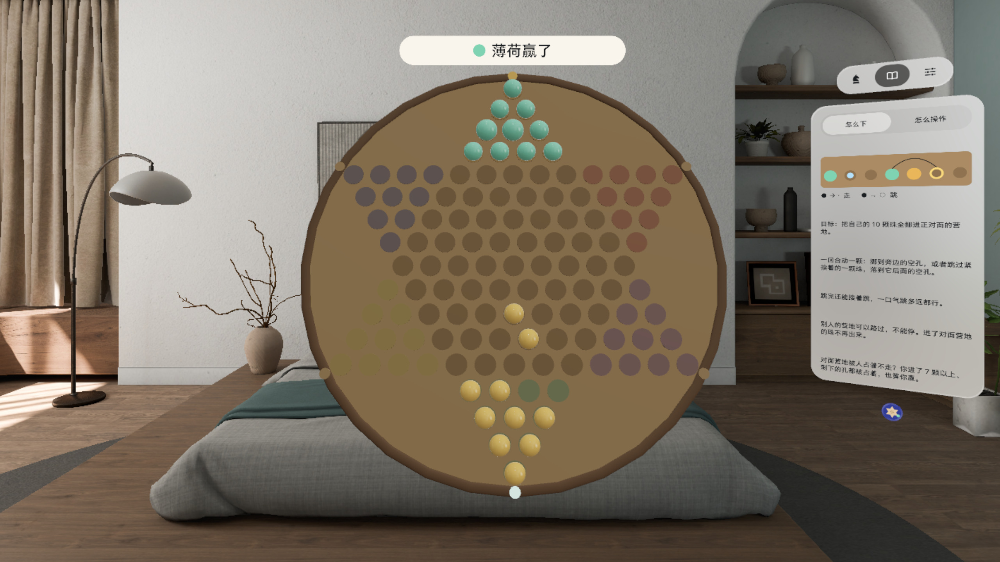 | 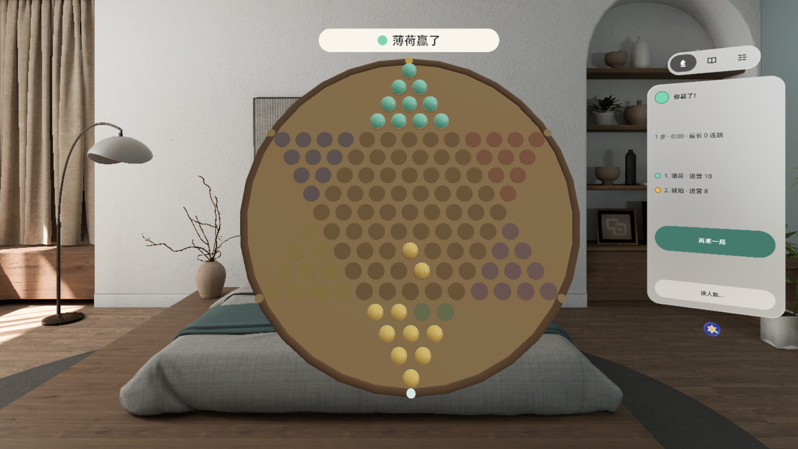 |

截图和演示视频都在 PICO 模拟器里用调试命令驱动拍摄，**非真实手势录像**。

### 安装

从 [v0.1.2 Release](https://github.com/kejing-dev/MarbleHop/releases/tag/v0.1.2) 下载 `MarbleHop-v0.1.2.apk`
（未签名的 release 包；需要自己签名，或用 `./gradlew assembleDebug` 自己出 debug 包），然后：

```
adb install -r MarbleHop-v0.1.2.apk
pico-cli app launch io.embodit.marblehop
```

开发说明、调试命令、QA 截图清单见 [AGENTS.md](AGENTS.md)。
